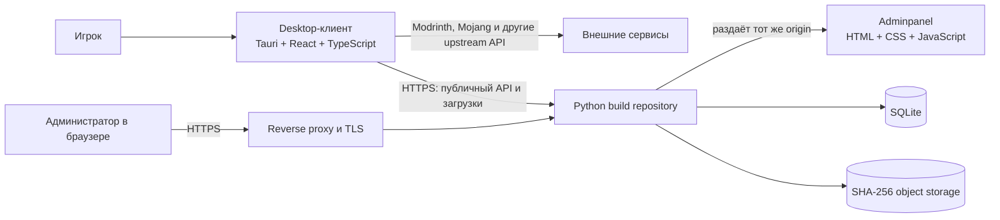

# MyLauncher

MyLauncher — Windows-лаунчер Minecraft Java Edition с управлением игровыми инстансами, аккаунтами, модификациями и локальными серверами. Дополнительный сервер позволяет публиковать собственные сборки, а встроенная веб-панель — управлять релизами и файлами.

Проект состоит из desktop-клиента на Tauri, Python-сервера репозитория и статической adminpanel. Панель обслуживается backend-сервером и использует его API; отдельный frontend-сервер для неё не нужен.

## Возможности

- Создание и обслуживание игровых инстансов с Vanilla, Fabric, Forge и NeoForge.
- Вход через Microsoft Device Code Flow или создание локального offline-профиля.
- Каталоги Modrinth и собственного репозитория: установка модов и сборок с проверкой файлов.
- Установка и управление локальными Minecraft-серверами.
- Публикация версий собственных сборок со stable/beta-каналами, проверкой готовности, аудитом и резервным копированием.
- Локальное хранение игровых данных; серверная часть может развёртываться отдельно.

## Архитектура



Сервер и adminpanel — необязательная часть для тех, кому нужен собственный каталог сборок. Без них клиент работает с локальными инстансами и поддерживаемыми внешними каталогами.

## Структура репозитория

```text
Client/MC-launcher/                 Desktop-клиент и Tauri backend
Server/MC-launcher-server/          Python API, SQLite, blob storage и backup
Server/MC-launcher-adminpanel/      Веб-интерфейс администратора
```

## Быстрый старт

### Desktop-клиент

Требуются Windows 10/11, Node.js с npm, Rust toolchain, Microsoft C++ Build Tools и WebView2 Runtime.

```powershell
cd .\Client\MC-launcher
npm install
npm run tauri dev
```

Команды сборки, проверки и требования Microsoft-входа описаны в [README клиента](Client/MC-launcher/README.md).

### Собственный каталог сборок

Для backend требуется Python 3.11 или новее. Перед запуском проверьте `Server/MC-launcher-server/server_config.json`: для локальной разработки или размещения за reverse proxy задайте `host` как `127.0.0.1`. Не публикуйте порт `8787` напрямую в интернет.

```powershell
cd .\Server\MC-launcher-server
py -3.12 .\start_local.py
```

Первый запуск запросит пароль администратора и сохранит его salted scrypt-хэш в конфигурации. Затем панель доступна по адресу `http://127.0.0.1:8787/`, а проверка backend — `http://127.0.0.1:8787/api/health`. Инструкции по HTTPS, службам Windows, обновлению и восстановлению см. в [README сервера](Server/MC-launcher-server/README.md).

Описание интерфейса и его связи с API находится в [README adminpanel](Server/MC-launcher-adminpanel/README.md).

## Безопасность

Используйте HTTPS для удалённого доступа к собственному каталогу и ограничивайте доступ к административной панели. Серверный порт `8787` должен оставаться доступен только локально за reverse proxy. Манифесты и контрольные суммы подтверждают целостность файлов, но не безопасность содержимого: игровые моды и сборки могут исполнять сторонний код. Подключайте только источники, которым доверяете.

Для входа Microsoft клиенту нужен Client ID публичного приложения Microsoft Entra; client secret не требуется и не должен встраиваться в приложение. Подробнее — в README клиента.

## Документация компонентов

- [Desktop-клиент](Client/MC-launcher/README.md)
- [Сервер собственного репозитория](Server/MC-launcher-server/README.md)
- [Веб-панель администратора](Server/MC-launcher-adminpanel/README.md)
